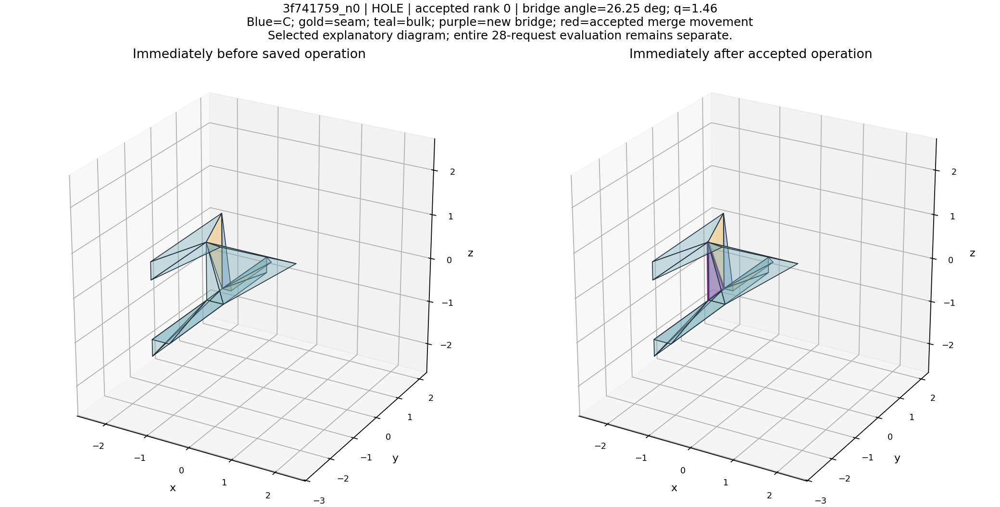
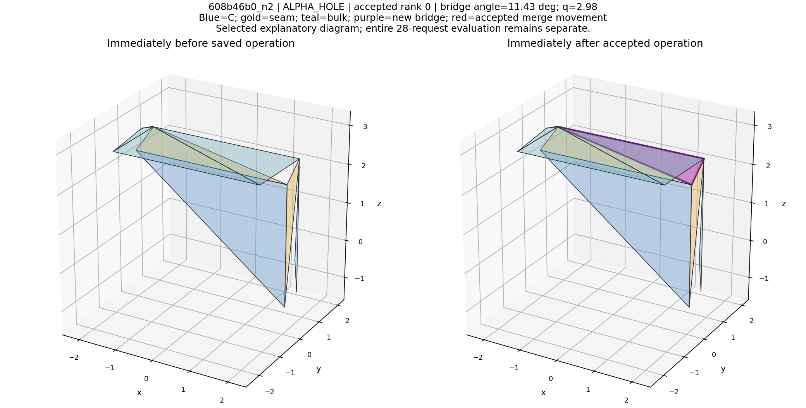

# HINGE V2：有限位置合并与三边环补面 CPU 实验

**结论：取得了真实但有限的局部正结果。** 多位置合并减少旧 FF 并增加合法连接；精确三边环补面在部分固定截面中填掉缺口，并使 DEV `608/n2` 首次接入 38 张原 bulk 面、28.820738% 的原 bulk 面积。与此同时，原定 ≥30% 可达门槛的身份仍为 TRAIN 14/16、DEV 0/12；I 有两例小幅上升。不能记为全面解决 DEV，也不能记为严格全指标零退化。

建议将代码与证据保留为独立 CPU 后处理候选。此次未切换默认、未修改正式采样入口、未训练或调用 D0，未 commit/push。

## 冻结合同与执行范围

读取同一28份 `PLAIN_S2000 + HINGE_OPP015`：4 TRAIN父×4噪声、3 DEV父×4噪声。比较原基线和四个处理臂，共112处理单元、140份完整评分。原RAW、单次D0、输入C、噪声、2048个C评分查询与显示位置全部复用。

| 臂 | 唯一处理 |
|---|---|
| MIDPOINT_REPLAY | 再扫一遍原中点/固定锚点规则，控制二次扫描效应 |
| ALPHA | 同一候选/排序，原位置优先，随后有限α∈{0,.25,.5,.75,1}；FP32目标去重 |
| HOLE | 仅填实际索引已围成的三开放边环，至少邻接一张SEAM，全部邻面为free |
| ALPHA_HOLE | 上述 ALPHA 的已保存结果，再按同一规则补面 |

位移预算始终为相对原PRE_GEO的全簇角点1.5%L。含C锚簇只能使用原锚点。没有法向偏移、额外弹性拉伸、扩大焊接半径、edge flip、重网格化或训练。原子段分裂没有混入本轮。每臂队列固定，按预登记顺序贪心，一次扫描，未按结果追加迭代。

新增桥面是新的有限表面，不是假装已有面被细分。它的 `parent_post_face_id`、`parent_source_raw_slot` 为−1、角色为BRIDGE；可作为合法连接图路径，但不计入原BULK面积。旧面不删除，C坐标/来源索引与seam固定锚保持。

## 先纠正附件中的因果推断

593 对是终态“seam侧边与bulk开放边共一个实际索引顶点”的子段候选全集，并非原HINGE队列。独立按角度筛，144/593满足≤20°，而非只有5对；完整串联筛选则为593→反向324→投影落于[.15,.85]的56→角度9→距离3/6→PRE簇预算3/5（两列为1.5%/2.5%）。

原HINGE本来没有20°轴线门槛。593对中仅27对曾进入旧HINGE队列，566对未进入；只有1对属于旧NEW_FF拒绝后仍存在的seam–bulk侧边候选。因此，不能把其余588对都解释成“角度不平行”或“本来缺一块楔形面”。

两自由簇的原合并目标确实是中点；有C锚时则固定C。因此本轮多α具有明确的新变量。精确三边环普查另外发现378个全部索引环，33个结构候选、16个通过初步形状与绕序门禁。它们来自实际拓扑，不是由子段拒绝原因推出来的。

## 全组质量与连接账本

百分数为逐请求宏均值；边数、单面孤岛为28份合计。固定父FF/CF以原HINGE保留free面为分母；实际FF包含新桥。

| 方法 | 固定父FF % | 实际FF % | 固定父CF % | I % | 合法共边总数 | 单面孤岛总数 | 新桥面 |
|---|---:|---:|---:|---:|---:|---:|---:|
| 原 HINGE_OPP015 | 13.49022 | 13.49022 | 2.78779 | 1.68457 | 4729 | 221 | 0 |
| 原中点重扫 | 13.32788 | 13.32788 | 2.78779 | 1.68457 | 4734 | 220 | 0 |
| 多位置 ALPHA | 13.04628 | 13.04628 | 2.78779 | 1.69678 | 4792 | 201 | 0 |
| 仅三边环补面 | 13.49022 | 13.44452 | 2.78779 | 1.68457 | 4777 | 217 | 16 |
| ALPHA 后补面 | 13.04628 | 12.99550 | 2.78779 | 1.69678 | 4840 | 198 | 16 |

ALPHA接受56次合并，其中51次使用了原中点以外的位置，5次仍用原位置。独立中点重扫仅接受5次。相对原基线，ALPHA新增63条合法共边、消除15对旧非法FF；中点重扫为新增5条、消除5对。比较两条完整处理链，ALPHA额外消除10对旧FF；这支持有限位置选择确有增量，不能把全部收益归给第二次扫描。

仅HOLE加入16张桥，新增48条合法共边，但原非法面对及原受影响面不变。其实际FF从13.49022%降为13.44452%，**全部是新增合法面扩大分母**；固定父FF完全不变。ALPHA_HOLE的真实固定父FF收益来自ALPHA，而非补面本身。

组合共新增111条合法共边，其中48条是桥面与邻面的边；不能称为新增111条C/F接口。C/F合法共边总数在所有臂均为315。独立审计确认原4729条合法共边全部保留：新增非法CF/FF、未决接触、非流形边、同向双面边和删原面均为0。这不消除基线原有非法几何，也不等于水密或全局流形认证。

## TRAIN与DEV分开看

| 分组 / 方法 | 原bulk可达宏均值 % | ≥30%请求 | 固定父FF % | I % |
|---|---:|---:|---:|---:|
| TRAIN / 原 HINGE_OPP015 | 61.51706 | 14/16 | 12.47663 | 0.17090 |
| TRAIN / 原中点重扫 | 61.51381 | 14/16 | 12.47663 | 0.17090 |
| TRAIN / 多位置 ALPHA | 64.25582 | 14/16 | 12.47663 | 0.17090 |
| TRAIN / 仅三边环补面 | 61.52163 | 14/16 | 12.47663 | 0.17090 |
| TRAIN / ALPHA 后补面 | 64.26007 | 14/16 | 12.47663 | 0.17090 |
| DEV / 原 HINGE_OPP015 | 0.00000 | 0/12 | 14.84167 | 3.70280 |
| DEV / 原中点重扫 | 0.00000 | 0/12 | 14.46288 | 3.70280 |
| DEV / 多位置 ALPHA | 0.00000 | 0/12 | 13.80582 | 3.73128 |
| DEV / 仅三边环补面 | 2.40341 | 0/12 | 14.84167 | 3.70280 |
| DEV / ALPHA 后补面 | 2.40341 | 0/12 | 13.80582 | 3.73128 |

TRAIN新增可达原bulk主要在73/n0（+3面）、73/n2（+18面）、85/n3（+1面）。不是只把桥面积加进分子；原正例身份全部保留，但没有新跨过30%门槛的请求。

DEV的两个真实新增路径来自HOLE：`608/n2`新增38张原bulk面，0→28.820738%；`2d/n2`新增1张原bulk面，0→0.020161%。前者是值得保留的局部接续证据，后者只是极小连接。阈值预先固定为30%，不能事后降低以改写0/12，但也不能因为没过30%便把28.82%的进展写成零收益。其余10个DEV请求原bulk可达仍为0。

DEV固定父FF由14.84167%降为ALPHA的13.80582%；原中点重扫为14.46288%。这轮可以改善bulk内部冲突，尚未普遍建立seam到bulk的通路。

## 不能省略的代价

- ALPHA/组合的I宏均值1.684570%→1.696777%，增加0.012207个百分点；DEV增加0.028483个百分点。实际上涨为608/n1的+0.146484个百分点、608/n3的+0.195313个百分点。I是固定C查询的近表面冲突覆盖，不与“新增精确非法面对=0”等价。
- 原父小角面比例宏均值24.744693%→24.699631%，仍然很高。组合的q均值总体下降，但85/n3、8c/n0、608/n0的q均值分别小幅上升约0.012775、0.001975、0.003419。局部门禁不保证每个连续质量指标单调改善。
- 新桥必须angle≥5°、q≤10，且未产生非法CF/FF；但这只是当前几何合法性，不认证它一定符合未知用户设计意图。608/n2桥在侧截面产生了新的斜线，必须作为新增表面说明。
- 28个请求来自长期观察的7父；这是固定面板上的后处理可行性结果，不是新父/新噪声广泛泛化结论。

## 实际图审与固定截面

全28张五列对照图已经实际打开：TRAIN16张由并行评阅者逐张查看并记录64条四臂对照，DEV12张由root逐张查看并记录12组五列观察；另有独立复看与局部科学图。全部标记AI_PROXY、非盲，不宣称人类评分。

3f/n0、3f/n2的前截面左下竖向缺口，在HOLE两臂中确实闭合；8c/n0与8c/n3也有局部缺段闭合。大部分整体外形不变，未见明显新增整体崩坏，但原有许多分离短线和间隔仍在，不能据此声称悬片全面消除。

[全部固定外观与前/侧截面图](gallery/index.html) · [TRAIN实际图审](gallery/review_train.csv) · [DEV实际图审](review_dev.csv) · [独立固定案例复看](visual/independent_fixed_cases.json)

下图仅是已评分全组中的解释案例，不替代完整面板。蓝C、金SEAM、青BULK、紫BRIDGE。





## 可复算交付与核验

- [逐输出完整表](scores/per_output.csv)：140行、179个数值字段，原135字段全保留，另有44个固定父口径与BRIDGE字段；每个评分目录保留实际面对、面形状、合法边、查询向量和分母。
- [全指标逐输出配对](paired_per_output.csv)30,072条、[逐父配对](paired_per_parent.csv)7,518条、[分组全指标](metric_summary.csv)、[所有代价个例](all_regressions.csv)234条，不只报告有利数值。代价数是多对照、多指标记录数，不是234份坏输出。
- [几何候选/拒绝汇总](geometry_summary.csv)、`cells/`逐位置尝试记录、[原593分层诊断](diagnostics/)。
- [112格独立几何审计](independent_audit.json)：重放目标公式、原PRE簇位移、形状、桥面身份及保护合同。
- [完整扫描对账](independent_score_pair_audit.json)：140输出、122129条接触记录逐对一致；23份有桥输出实际进行了独立完整原检测扫描，与增量面对缓存一致。
- [独立关键指标审计](independent_key_metrics_audit.json)：140实际合法图重建、3080项数值核验；原bulk分母不含桥。28基线×135=3780项旧指标与新适配器一致。
- `source_snapshot/`包含本轮实现与实际评分依赖，`source_hashes.json`和`code.diff`保留来源；`protocol.json`、`ledger.jsonl`、资源记录及`RUN_COMPLETE.json`用于恢复/验证。

初始资源：RTX5080 16303MiB、已用2813MiB、空闲13167MiB、利用率2%；本轮未使用GPU。24逻辑CPU、约61GiB可用RAM。先跑正式首请求测得约106MiB RSS，再使用4个独立单线程CPU worker；评分另测峰值后4worker，图集另测后3worker。没有中止其他进程。

实际几何矩阵 64.23s；完整评分 30.50s；固定图集 8.56s。这些不包含实现、独立审计和实际阅读图片的时间，不能当作整轮只花一分钟。CPU并行墙钟也不是孤立单worker速度。

恢复：

```bash
PYTHONPATH=/mnt/e/MeshFlow/r2/src OMP_NUM_THREADS=1 OPENBLAS_NUM_THREADS=1 \
 /mnt/e/MeshFlow-Control-artifacts/venv/bin/python -B -m r2.tools.hinge_v2_cpu_v1.resume
```

完成后仅核验hash并退出，不追加几何尝试或模型执行。

## 本轮决策

**保留ALPHA与真实三边环补面的独立实现和局部正结果，暂不替换现有正式HINGE。** ALPHA有超出中点重扫的FF与连接增量；HOLE确实填补了可见缺口并让一个DEV请求接入较大原bulk区域。它们没有解决全部DEV，也有I和局部形状代价。

若继续，最有信息量的是在另一个预先固定的小面板上验证这两项后处理是否复现，并检查I与新增桥的用途；不据本轮直接启动附件建议的训练loss或扩大几何搜索。当前固定任务完成后停止。
